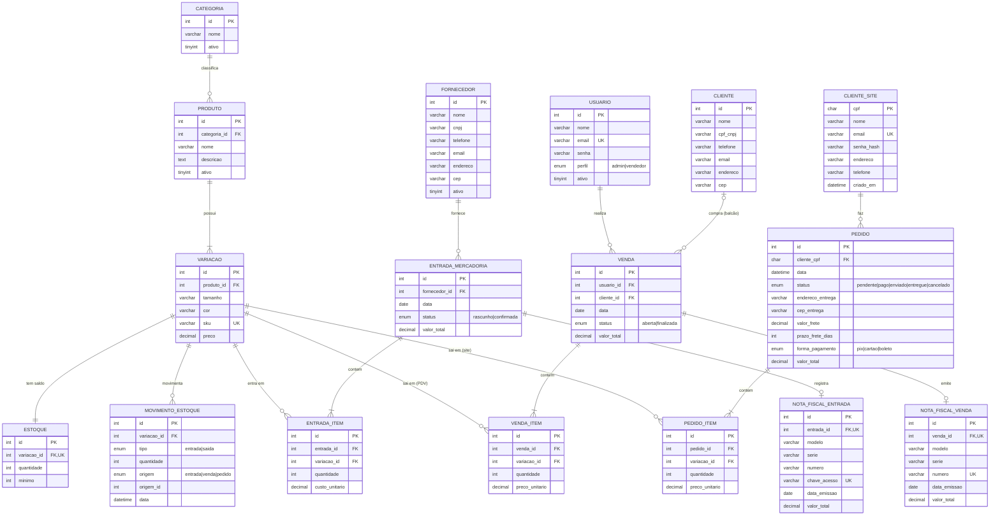
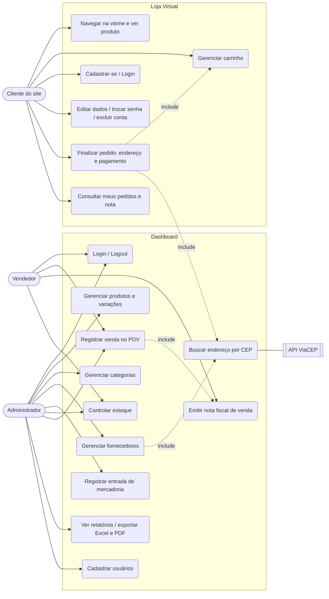
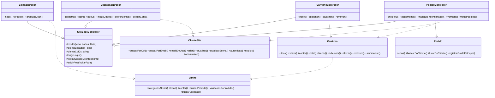
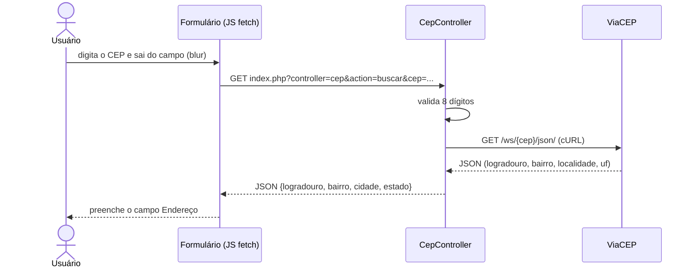
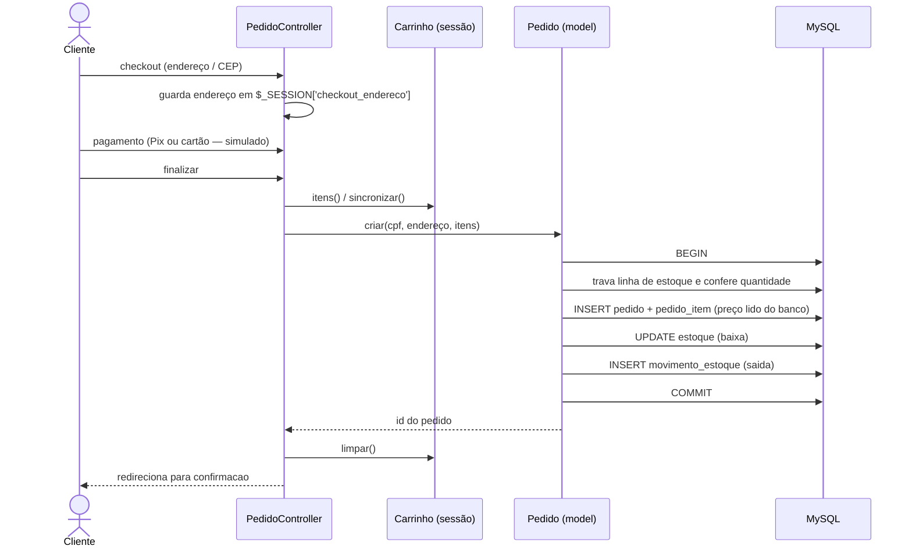
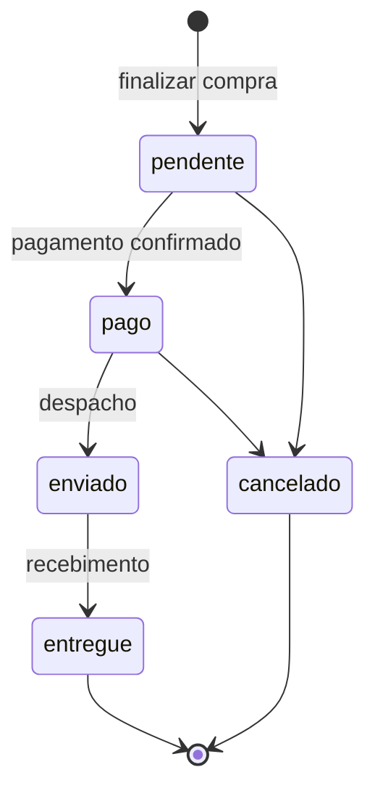

# Loja Cosplay — ERP (Dashboard) + Loja Virtual (Cliente)

Sistema em **PHP 8 + MySQL (PDO)** com arquitetura **MVC simples**, composto por dois módulos que usam o **mesmo banco** `loja_roupas`:

| Módulo | Público | Entrada |
|---|---|---|
| **Dashboard (ERP)** | Administrador e Vendedor | `index.php` (tela de login) |
| **Loja virtual** | Cliente | `index.php?controller=loja&action=index` |

**Dashboard:** produtos com variações (tamanho/cor/SKU), categorias, fornecedores (com ViaCEP), entrada de mercadorias, estoque com mínimo, vendas de balcão (PDV) com nota fiscal, relatórios (KPIs, Excel, PDF).
**Loja virtual:** vitrine, carrinho, cadastro/login do cliente, checkout em duas etapas com ViaCEP, pagamento simulado, nota fiscal do pedido e histórico de pedidos.

> Os diagramas usam **Mermaid** (renderizam no GitHub, VS Code, Obsidian e em https://mermaid.live).

## Sumário

1. [Requisitos](#1-requisitos)
2. [Instalação (XAMPP)](#2-instalação-xampp)
3. [Estrutura de pastas](#3-estrutura-de-pastas)
4. [Banco de dados (DER)](#4-banco-de-dados-der)
5. [Diagramas UML](#5-diagramas-uml)
6. [Rotas](#6-rotas)
7. [Recursos do site do cliente](#7-recursos-do-site-do-cliente)
8. [ViaCEP no Dashboard](#8-viacep-no-dashboard)
9. [Manual de uso](#9-manual-de-uso)
10. [Decisões técnicas e segurança](#10-decisões-técnicas-e-segurança)
11. [Limitações e pontos de atenção](#11-limitações-e-pontos-de-atenção)
12. [Glossário](#12-glossário)

---

## 1. Requisitos

- PHP 8+ com as extensões `pdo_mysql`, `mbstring` e `curl` (todas ativas por padrão no XAMPP). A `curl` é usada pelo `CepController` para consultar o ViaCEP.
- MySQL/MariaDB com tabelas em **InnoDB** (necessário para as chaves estrangeiras e para a transação do pedido).
- Composer com as dependências já instaladas em `vendor/` (usa `dompdf/dompdf` para gerar PDFs).

## 2. Instalação (XAMPP)

1. Copie o projeto para `C:\xampp\htdocs\loja_roupas`.
2. Inicie **Apache** e **MySQL** no XAMPP.
3. No phpMyAdmin, crie o banco `loja_roupas` e importe **`loja_roupas.sql`** (dump completo).
4. Se estiver **acrescentando o site a um projeto que já tem o dashboard**: com `loja_roupas.sql` anterior importado, importe **`sql/cliente_site.sql`** (cria `cliente_site`, `pedido` e `pedido_item`; não altera tabelas existentes) e copie as pastas/arquivos mantendo a estrutura. **Não sobrescreva** `config/db.php`. No `index.php`, não substitua o seu: copie apenas o `require_once __DIR__ . '/config/helpers.php';` e os `case` da loja (seção 6).
5. Confira `config/db.php` (padrão: `localhost`, usuário `root`, senha vazia, banco `loja_roupas`).
6. Acesse:
   - Dashboard: `http://localhost/loja_roupas/index.php`
   - Loja: `http://localhost/loja_roupas/index.php?controller=loja&action=index`

**Imagens dos produtos:** sem coluna no banco. Coloque o arquivo em `public/uploads/produtos/{id_do_produto}.jpg` (ou `.png`, `.webp`). Sem arquivo, aparece `public/assets/img/placeholder.svg`.

## 3. Estrutura de pastas

```
loja_roupas/
├── index.php                      roteador (front controller)
├── loja_roupas.sql                dump completo do banco
├── composer.json / composer.lock  dependências (Dompdf)
├── config/
│   ├── db.php                     conexão PDO (Database::getConnection)
│   ├── helpers.php                e(), moeda(), formatarCep(), CSRF (site e painel), flash, imagemProduto()...
│   │                              (validarCpf() está COMENTADA de propósito: o projeto aceita CPF fictício;
│   │                               para validar CPF real, descomente a função e chame-a em ClienteController::validarDados)
│   └── correios.php               (reservado ao cálculo de frete; ainda não é usado)
├── controllers/
│   ├── AuthController.php         login, dashboard, logout, check(), onlyAdmin()
│   ├── UsuarioController.php      cadastro de usuários
│   ├── ProdutoController.php, VariacaoController.php, CategoriaController.php
│   ├── FornecedorController.php, EntradaController.php
│   ├── VendaController.php        PDV + nota fiscal de venda
│   ├── RelatorioController.php    KPIs, Excel, PDF
│   ├── CepController.php          consulta ViaCEP (curl) → JSON  [dashboard e site]
│   ├── SiteBaseController.php     base comum (login, render, CSRF) dos controllers do cliente
│   ├── LojaController.php         vitrine
│   ├── CarrinhoController.php     carrinho
│   ├── ClienteController.php      cadastro, login, meus dados
│   └── PedidoController.php       checkout, pagamento, finalizar, confirmação, meus pedidos, nota
├── models/
│   ├── usuario, produto, variacao, categoria, fornecedor, entrada, venda, cliente, estoque  (.php)
│   ├── NotaFiscal.php, Relatorio.php
│   └── Vitrine.php, Carrinho.php, ClienteSite.php, Pedido.php   (lado do cliente)
├── views/
│   ├── login, dashboard, cadastro, produtos, variacoes, categorias, fornecedores,
│   │   entrada(s), vendas, relatorios, relatorio_pdf, nota_fiscal_venda  (.php)
│   ├── nota_fiscal_pedido.php     template da nota do pedido
│   └── site/                      telas do cliente: _header, _footer, home, produto, carrinho,
│                                  cadastro, login, meus_dados, checkout, pagamento,
│                                  confirmacao, meus_pedidos, nao_encontrado
├── public/
│   ├── assets/css/                style.css (dashboard), loja.css (site), nota.css
│   ├── assets/js/loja.js          seletor de variação, máscaras de CPF/telefone
│   ├── assets/img/                placeholder.svg, qrcode-pix.svg, dashboard.png e site.png (ícones das abas)
│   └── uploads/produtos/          imagens dos produtos
├── sql/cliente_site.sql           cliente_site + pedido + pedido_item
└── vendor/                        Dompdf (Composer)
```

As pastas `config`, `models`, `controllers`, `views` e `sql` têm `.htaccess` bloqueando o acesso direto pelo navegador.

**Fluxo de uma requisição:** `index.php?controller=X&action=Y` → o `index.php` valida os nomes (somente letras e números) → instancia `XController` → executa o método público `Y` → o controller chama o **model** → carrega a **view**. Métodos iniciados por `__`, privados e protegidos não são chamáveis pela URL.

## 4. Banco de dados (DER)



**Observações de modelagem**
- `venda`/`venda_item` = **PDV do vendedor**; `pedido`/`pedido_item` = **e-commerce**. São canais separados que compartilham `variacao`, `estoque` e `movimento_estoque`.
- `cliente` (balcão, PK inteira, CPF/CNPJ) e `cliente_site` (loja, PK = CPF) são tabelas distintas.
- `movimento_estoque.origem_id` aponta para a entrada, venda ou pedido conforme `origem` (relação polimórfica, sem FK).
- `estoque` é 1:1 com `variacao` (UNIQUE em `variacao_id`).
- Exclusão: itens e notas usam `ON DELETE CASCADE`; `venda.cliente_id` usa `ON DELETE SET NULL`.

### SQL do lado do cliente (`sql/cliente_site.sql`)

Rodar **depois** de importar `loja_roupas.sql`. Não altera tabelas existentes.

```sql
USE loja_roupas;

CREATE TABLE IF NOT EXISTS cliente_site (
  cpf        CHAR(11)     NOT NULL PRIMARY KEY,   -- somente dígitos
  nome       VARCHAR(100) NOT NULL,
  email      VARCHAR(100) NOT NULL UNIQUE,
  senha_hash VARCHAR(255) NOT NULL,
  endereco   VARCHAR(255) NOT NULL,
  telefone   VARCHAR(20)  NULL,
  criado_em  DATETIME     NOT NULL DEFAULT CURRENT_TIMESTAMP
) ENGINE=InnoDB DEFAULT CHARSET=utf8mb4 COLLATE=utf8mb4_general_ci;

CREATE TABLE IF NOT EXISTS pedido (
  id               INT AUTO_INCREMENT PRIMARY KEY,
  cliente_cpf      CHAR(11)      NOT NULL,
  data             DATETIME      NOT NULL DEFAULT CURRENT_TIMESTAMP,
  status           ENUM('pendente','pago','enviado','entregue','cancelado') NOT NULL DEFAULT 'pendente',
  endereco_entrega VARCHAR(255)  NOT NULL,
  valor_total      DECIMAL(10,2) NOT NULL DEFAULT 0.00,
  FOREIGN KEY (cliente_cpf) REFERENCES cliente_site(cpf) ON UPDATE CASCADE
) ENGINE=InnoDB DEFAULT CHARSET=utf8mb4 COLLATE=utf8mb4_general_ci;

CREATE TABLE IF NOT EXISTS pedido_item (
  id             INT AUTO_INCREMENT PRIMARY KEY,
  pedido_id      INT           NOT NULL,
  variacao_id    INT           NOT NULL,
  quantidade     INT           NOT NULL,
  preco_unitario DECIMAL(10,2) NOT NULL,
  FOREIGN KEY (pedido_id)   REFERENCES pedido(id)   ON DELETE CASCADE ON UPDATE CASCADE,
  FOREIGN KEY (variacao_id) REFERENCES variacao(id) ON UPDATE CASCADE
) ENGINE=InnoDB DEFAULT CHARSET=utf8mb4 COLLATE=utf8mb4_general_ci;
```

**Opcional** (já presente no dump completo; permite evoluir frete, forma de pagamento e `origem = 'pedido'` no estoque):

```sql
ALTER TABLE pedido
  ADD COLUMN cep_entrega      VARCHAR(9)    NULL AFTER endereco_entrega,
  ADD COLUMN valor_frete      DECIMAL(10,2) NOT NULL DEFAULT 0 AFTER cep_entrega,
  ADD COLUMN prazo_frete_dias INT           NULL AFTER valor_frete,
  ADD COLUMN forma_pagamento  ENUM('pix','cartao','boleto') NOT NULL DEFAULT 'pix' AFTER prazo_frete_dias;

ALTER TABLE movimento_estoque
  MODIFY origem ENUM('entrada','venda','pedido') NOT NULL;
```

## 5. Diagramas UML

### 5.1 Casos de uso



### 5.2 Classes — Dashboard

```mermaid
classDiagram
    class Database { -conn$ : PDO ; +getConnection()$ PDO }

    class AuthController { +form() +login() +dashboard() +logout() +check() +onlyAdmin() }
    class UsuarioController { +create() +store() }
    class ProdutoController { +index() +salvar() +toggle() +deletar() +listarJson() }
    class VariacaoController { +index() +salvar() +deletar() }
    class CategoriaController { +index() +salvar() +deletar() +toggle() }
    class FornecedorController { +index() +salvar() +toggle() }
    class EntradaController { +index() +salvar() }
    class VendaController { +index() +salvar() +emitirNota() +verNota() +buscarClientePorCpf() }
    class RelatorioController { +index() +exportarExcel() +exportarPdf() }
    class CepController { +buscar() }

    class Usuario { +buscarPorEmail() +cadastrar() }
    class Produto { +listarComCategoria() +buscarPorId() +inserir() +atualizar() +setAtivo() +deletar() }
    class Variacao { +listarPorProduto() +buscarPorId() +inserir() +atualizar() +deletar() }
    class Categoria { +listarTodas() +listarAtivas() +inserir() +atualizar() +setAtivo() +deletar() }
    class Fornecedor { +listarTodos() +listarAtivos() +buscarPorId() +inserir() +atualizar() +setAtivo() }
    class Entrada { +listarComFornecedor() +buscarItensDaVariacao() +registrar() }
    class Venda { +listarRecentes() +buscarPorId() +registrar() }
    class Cliente { +buscarPorId() +buscarPorCpf() +criarAPartirDoSite() }
    class Estoque { +garantirRegistro() +buscarPorVariacao() +ajustar() +listarBaixoEstoque() +contarBaixoEstoque() }
    class NotaFiscal { +buscarPorVenda() +emitirParaVenda() +buscarPorEntrada() +registrarParaEntrada() }
    class Relatorio { +kpiVendasMes() +kpiEntradasMes() +kpiEstoqueBaixo() +topProdutosMaisVendidos() +fornecedoresComMaisEntregas() }

    AuthController ..> Usuario
    AuthController ..> Relatorio
    UsuarioController ..> Usuario
    ProdutoController ..> Produto
    ProdutoController ..> Variacao
    VariacaoController ..> Variacao
    VariacaoController ..> Estoque
    CategoriaController ..> Categoria
    FornecedorController ..> Fornecedor
    EntradaController ..> Entrada
    EntradaController ..> Estoque
    VendaController ..> Venda
    VendaController ..> Cliente
    VendaController ..> NotaFiscal
    VendaController ..> Estoque
    RelatorioController ..> Relatorio
    Produto ..> Database
    Variacao ..> Database
    Venda ..> Database
    Estoque ..> Database
```



### 5.3 Classes — Loja virtual



### 5.4 Sequência — ViaCEP (dashboard e site)



### 5.5 Sequência — Finalizar pedido



### 5.6 Estados do pedido



> No projeto atual todo pedido nasce `pendente`; não há tela do vendedor para mudar o status (ver seção 11).

## 6. Rotas

Padrão: `index.php?controller=X&action=Y`

| controller | actions |
|---|---|
| `auth` | `form`, `login`, `dashboard`, `logout` |
| `usuario` | `create`, `store` |
| `produto` | `index`, `salvar`, `toggle`, `deletar`, `listarJson` |
| `variacao` | `index`, `salvar`, `deletar` |
| `categoria` | `index`, `salvar`, `deletar`, `toggle` |
| `fornecedor` | `index`, `salvar`, `toggle` |
| `entrada` | `index`, `salvar` |
| `venda` | `index`, `salvar`, `emitirNota`, `verNota`, `buscarClientePorCpf` |
| `relatorio` | `index`, `exportarExcel`, `exportarPdf` |
| `cep` | `buscar` (`&cep=00000000`, devolve JSON) |
| `loja` | `index` (filtros `categoria_id`, `q`, `pagina`), `produto` (`&id=X`), `produtosJson` |
| `carrinho` | `index`; POST: `adicionar`, `atualizar`, `remover` |
| `cliente` | `cadastro`, `login`, `logout`, `meusDados`, `alterarSenha`, `excluirConta` |
| `pedido` | `checkout`, `pagamento`, `finalizar`, `confirmacao` (`&id=N`), `meusPedidos`, `verNota` (`&id=N`) |

**Cases da loja no `index.php`** (para copiar num projeto que já tem o dashboard):

```php
case 'loja':
    require_once __DIR__ . '/config/helpers.php';
    require_once __DIR__ . '/controllers/LojaController.php';
    $c = new LojaController();
    break;
case 'carrinho':
    require_once __DIR__ . '/config/helpers.php';
    require_once __DIR__ . '/controllers/CarrinhoController.php';
    $c = new CarrinhoController();
    break;
case 'cliente':
    require_once __DIR__ . '/config/helpers.php';
    require_once __DIR__ . '/controllers/ClienteController.php';
    $c = new ClienteController();
    break;
case 'pedido':
    require_once __DIR__ . '/config/helpers.php';
    require_once __DIR__ . '/controllers/PedidoController.php';
    $c = new PedidoController();
    break;
case 'cep':
    require_once __DIR__ . '/controllers/CepController.php';
    $c = new CepController();
    break;
```

## 7. Recursos do site do cliente

Cada item lista controllers/models/views envolvidos e se exige SQL adicional.

### 7.1 Vitrine, carrinho, cadastro e login (base)
- **Controllers:** `LojaController`, `CarrinhoController`, `ClienteController`, `SiteBaseController`.
- **Models:** `Vitrine`, `Carrinho`, `ClienteSite`.
- **SQL:** o de `sql/cliente_site.sql`. Nada além disso.

### 7.2 Busca de CEP com ViaCEP
- **O que faz:** consulta `https://viacep.com.br/ws/{cep}/json/` via `curl` e devolve rua, bairro, cidade e UF em JSON.
- **Controller:** `controllers/CepController.php` (rota `cep&action=buscar`).
- **Onde é usado:** `views/site/checkout.php` (endereço de entrega), `views/site/meus_dados.php` (cadastro) e `views/fornecedores.php` (dashboard, ver seção 8). Todos fazem `fetch()` para a mesma rota ao digitar 8 dígitos.
- **SQL:** nenhum no site. O endereço continua salvo como texto único em `cliente_site.endereco` e `pedido.endereco_entrega`; o CEP só ajuda a **montar** o texto.

### 7.3 Checkout em duas etapas (endereço → pagamento)
- **Fluxo:** (1) `checkout` — endereço de entrega; (2) `pagamento` — cartão ou Pix; (3) `finalizar` — cria o pedido de fato. A antiga action `confirmar` foi removida.
- **Controller:** `PedidoController` (`checkout()`, `pagamento()`, `finalizar()`). **Views:** `checkout.php`, `pagamento.php`.
- **Estado entre etapas:** o endereço validado fica em `$_SESSION['checkout_endereco']` até `finalizar()` gravar o pedido e limpar a sessão.
- **Reaproveitar endereço cadastrado:** se o cliente já tem `endereco`, o checkout mostra "Usar endereço cadastrado" (padrão) ou "Usar outro endereço para este pedido"; CEP/rua/número só ficam visíveis e obrigatórios na segunda opção.

### 7.4 Forma de pagamento (cartão ou Pix) — ⚠️ SIMULADO
- **O que faz:** exibe dois métodos. Em **cartão** aparecem número, nome, validade e CVV; em **Pix** aparece um QR Code.
- **View:** `views/site/pagamento.php`. **CSS:** classes `.pgto-*` no final de `loja.css`.
- **⚠️ Não é pagamento de verdade:** os campos do cartão são validados só quanto a preenchimento (sem Luhn, sem bandeira, sem gateway) e **nada é salvo no banco**. O Pix não gera cobrança. Se o projeto for usado para vender de verdade, é obrigatório trocar por um gateway real (Stripe, Mercado Pago, PagSeguro etc.).
- **SQL:** nenhum — o método escolhido não é gravado.

### 7.5 QR Code do Pix — 🎉 contém uma brincadeira
- **O que é:** `public/assets/img/qrcode-pix.svg`, um QR Code **de verdade**, mas que **não aponta para um Pix** — aponta para um link de vídeo do YouTube, a pedido de quem encomendou o projeto.
- **Como foi gerado:** com a biblioteca Python `qrcode` (`pip install qrcode`), **fora** do projeto PHP. Para trocar o conteúdo (ex.: uma chave Pix real), gere um novo SVG por fora e substitua o arquivo.
- **Recomendação:** troque este arquivo antes de qualquer demonstração séria (professor, banca, cliente).

### 7.6 Nota fiscal do pedido
- **Controller:** `PedidoController::verNota()` (`pedido&action=verNota&id=N`); só o dono do pedido acessa.
- **View/template:** `views/nota_fiscal_pedido.php` (HTML com botão **Imprimir**).
- **Onde abrir:** link "Ver Nota Fiscal" em `views/site/confirmacao.php` e em cada pedido de `views/site/meus_pedidos.php`.
- **SQL:** nenhum. Diferente da NF do vendedor (`nota_fiscal_venda`, numeração sequencial via `models/NotaFiscal.php`), a nota do pedido é **montada na hora** a partir dos dados do pedido; o "número" é o ID com zeros à esquerda (ex.: `#000042`), sem valor fiscal oficial. A biblioteca Dompdf já está instalada e é usada no relatório do vendedor (`RelatorioController::exportarPdf()`).

## 8. ViaCEP no Dashboard

Formulário de fornecedores (`views/fornecedores.php`): ao digitar o CEP (`#campo-cep`) e sair do campo, o JavaScript chama `index.php?controller=cep&action=buscar&cep=...` e preenche o textarea `endereco` com `logradouro, bairro - cidade/UF`.

**Arquitetura:** `Formulário (fetch) → CepController (PHP + cURL) → ViaCEP`. O PHP intermedia para validar o CEP (8 dígitos), tratar erros (400 CEP inválido, 404 não encontrado, 502 serviço indisponível) e devolver só os campos usados (`cep`, `logradouro`, `bairro`, `cidade`, `estado`).

Teste direto: `index.php?controller=cep&action=buscar&cep=26272020`.

> ⚠️ A tabela `fornecedor` tem a coluna `cep`, mas `FornecedorController::salvar()` e `models/fornecedor.php` ainda **não gravam** o CEP (só o endereço). Para persistir: ler `$_POST['cep']` no controller e incluir `cep` no `INSERT`/`UPDATE` do model (e no `SELECT` de `listarTodos`, se quiser exibir).

## 9. Manual de uso

### 9.1 Dashboard

| Tarefa | Caminho |
|---|---|
| Entrar | Login com e-mail e senha (perfis `admin` e `vendedor`) |
| Categorias | Menu **Categorias** (admin) |
| Produtos | Menu **Produtos** → depois cadastrar as **variações** (tamanho, cor, SKU, preço) |
| Fornecedores | Menu **Fornecedores**; o CEP preenche o endereço (ViaCEP) |
| Entrada de mercadoria | Menu **Entradas** → fornecedor, variações, quantidade e custo → aumenta o estoque |
| Venda de balcão | Menu **Vendas** → buscar cliente por CPF → itens → finalizar → **emitir nota** |
| Acompanhamento | **Dashboard** (KPIs, estoque baixo) e **Relatórios** (Excel/PDF) |
| Ver a loja | Link "🛒 Visitar o site" no menu |

### 9.2 Loja virtual
1. **Vitrine:** filtrar por categoria, buscar por nome e abrir o produto.
2. **Produto:** escolher tamanho/cor → **Adicionar ao carrinho**.
3. **Carrinho:** alterar quantidades ou remover itens.
4. **Cadastro/Login:** CPF, nome, e-mail, senha, endereço e telefone.
5. **Checkout:** confirmar o endereço (ou informar outro com CEP) → **Pagamento** (simulado) → **Finalizar**.
6. **Meus pedidos:** status, itens, total e nota fiscal.
7. **Meus dados:** editar cadastro, trocar senha ou excluir conta.

## 10. Decisões técnicas e segurança

- **Sessão do cliente separada da do vendedor:** `$_SESSION['cliente_id']` (guarda o CPF) e `['cliente_nome']`; o carrinho fica em `$_SESSION['carrinho']`. Sair da conta do cliente não encerra a sessão do vendedor.
- **Pedido não usa `venda`/`venda_item`** (PDV): usa `pedido` e `pedido_item`, com o endereço de entrega gravado no pedido, status próprios e cliente identificado por CPF.
- **Estoque:** ao finalizar, em **uma transação**: trava a linha de `estoque`, confere a quantidade, grava o pedido, dá baixa e registra a saída em `movimento_estoque`. Se qualquer passo falhar, nada é gravado. O preço do pedido é sempre lido do banco, nunca da sessão.
- **`movimento_estoque`:** o código grava `variacao_id, tipo='saida', quantidade, origem='venda', origem_id=id do pedido`. Se as colunas da sua tabela tiverem outros nomes, ajuste **só** o método `registrarSaidaEstoque()` em `models/Pedido.php`.
- **`produto&action=listarJson`:** o projeto não altera o controller do vendedor. Use `loja&action=produtosJson` ou, para corrigir o antigo, remova `p.imagem` do SELECT.
- **Segurança:** prepared statements (PDO) em todas as consultas; `password_hash`/`password_verify`; token **CSRF** em todo POST; escape de saída (`e()` / `htmlspecialchars`); `session_regenerate_id` no login (painel e site); cadastro de vendedor só para admin logado; ações de ativar/inativar/excluir/emitir NF só por POST com token; erros do banco vão para o log (`error_log`), não para a tela; `index.php` só aceita `[a-zA-Z0-9]` em `controller`/`action`; rotas administrativas protegidas por `check()`/`onlyAdmin()`; `.htaccess` bloqueando pastas internas, o dump `.sql`, os `.md` e o `vendor/` (e `check.php` só local). Usuários do dump: `admin@cosplay.com` e `vendedor@cosplay.com`, senha `123456`.

## 11. Limitações e pontos de atenção

- Não há tela do vendedor para mudar o status do pedido (pendente → pago → enviado…); todo pedido fica `pendente`.
- Pagamento 100% simulado e QR Code do Pix com brincadeira (seções 7.4 e 7.5).
- Mesmo com `cep_entrega`, `valor_frete`, `prazo_frete_dias` e `forma_pagamento` existindo na tabela `pedido` do dump, o model atual **não grava** esses campos (ficam com os valores padrão); `config/correios.php` não implementa cálculo de frete.
- O model grava `origem = 'venda'` em `movimento_estoque` para pedidos do site; o ENUM já aceita `'pedido'`, mas o código não o usa.
- O CEP do formulário de fornecedores não é persistido (seção 8).
- `cliente` (balcão) e `cliente_site` (loja) são cadastros separados; `Cliente::criarAPartirDoSite()` existe para a ponte entre eles.

## 12. Glossário

| Termo | Significado |
|---|---|
| API | Interface para comunicação entre sistemas (ex.: ViaCEP) |
| DER | Diagrama Entidade-Relacionamento (modelo do banco) |
| PK / FK / UK | Chave primária / estrangeira / única |
| SKU | Código único de cada variação do produto |
| PDV | Ponto de venda (venda de balcão) |
| MVC | Model-View-Controller |
| CSRF | Ataque que força o usuário a enviar uma requisição sem querer; combatido com token em todo POST |